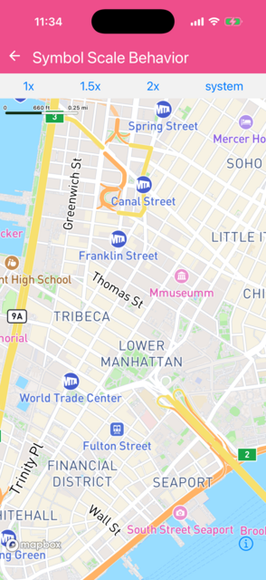

Scales map labels and icons by a fixed factor, or with the system text size setting.

[Try it on web](https://rnmapbox.github.io/example-app/Map/SymbolScaleBehavior)

```jsx
import { useState } from 'react';
import { Button, View } from 'react-native';
import { Camera, MapView } from '@rnmapbox/maps';

import { type ExampleWithMetadata } from '../common/ExampleMetadata'; // exclude-from-doc

const CENTER_COORD = [-74.00597, 40.71427];

type Behavior = 'system' | { fixed: number };

const OPTIONS: { title: string; value: Behavior }[] = [
  { title: '1x', value: { fixed: 1 } },
  { title: '1.5x', value: { fixed: 1.5 } },
  { title: '2x', value: { fixed: 2 } },
  { title: 'system', value: 'system' },
];

const SymbolScaleBehavior = () => {
  const [behavior, setBehavior] = useState<Behavior>({ fixed: 1.5 });

  return (
    <>
      <View style={{ flexDirection: 'row', justifyContent: 'space-around' }}>
        {OPTIONS.map(({ title, value }) => (
          <Button
            key={title}
            title={title}
            onPress={() => setBehavior(value)}
          />
        ))}
      </View>
      <MapView style={{ flex: 1 }} symbolScaleBehavior={behavior}>
        <Camera
          defaultSettings={{ centerCoordinate: CENTER_COORD, zoomLevel: 14 }}
        />
      </MapView>
    </>
  );
};

export default SymbolScaleBehavior;


```

}

